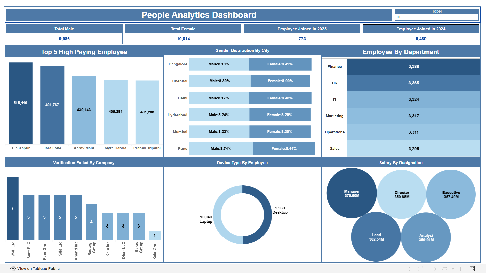

# 📊 People Analytics Dashboard | Tableau

## 📌 Project Overview

The **People Analytics Dashboard** is an interactive HR analytics project developed using Tableau to analyze workforce data and uncover meaningful business insights.

This dashboard provides a consolidated view of employee demographics, hiring trends, salary distribution, departmental headcount, gender distribution across cities, employee device preferences, and verification failures.

The objective is to transform raw HR data into actionable insights that support data-driven workforce planning and decision-making.

## 🎯 Project Objectives

- Analyze employee demographics and gender distribution.
- Monitor employee joining trends.
- Identify the highest-paid employees.
- Understand employee distribution across departments and cities.
- Analyze salary distribution by designation.
- Track employee verification failures by company.
- Understand employee device preferences.

## 📈 Key Dashboard Insights

Based on the dashboard analysis:

- **Workforce Distribution:** The organization has 20,000 employees, comprising 9,986 males and 10,014 females.
- **Hiring Trends:** 6,480 employees joined in 2024, while 773 employees joined in 2025.
- **Top-Paid Employee:** Ela Kapur has the highest displayed salary of 515,119.
- **City-Wise Distribution:** Pune records the highest displayed male percentage (8.74%), while its female percentage is 8.44%.
- **Departmental Analysis:** Finance has the highest employee count with 3,388 employees.
- **Verification Monitoring:** Wall Ltd records the highest number of verification failures (7).
- **Device Analysis:** 10,040 employees use laptops, while 9,960 use desktops.
- **Salary Analysis:** Manager has the highest displayed salary value across designations at 370.50M.

## 🛠️ Tools & Technologies

- **Tableau** – Dashboard development and data visualization.
- **Data Analytics** – Workforce analysis and business insights.
- **Data Visualization** – Interactive charts and KPI reporting.
- **GitHub** – Project documentation and version control.

## 📊 Dashboard Features

- Interactive KPI cards.
- Top N parameter for configurable analysis.
- Employee salary comparison.
- Gender distribution analysis.
- Department-wise employee distribution.
- Company-wise verification monitoring.
- Device type analysis.
- Designation-wise salary comparison.

## 💡 Business Impact

This dashboard helps HR teams and business stakeholders:

- Gain a better understanding of workforce composition.
- Monitor hiring and employee distribution trends.
- Identify salary patterns across employees and designations.
- Track verification-related issues.
- Support workforce planning through interactive visualizations.
  ## 📊 Dashboard Preview

  

## 🔗 Live Tableau Dashboard

Explore the interactive dashboard published on Tableau Public:

  

**Tableau Public Profile:** [Chinmayee Y](https://public.tableau.com/app/profile/chinmayee.y)

**Dashboard:** [People Analytics Dashboard](https://public.tableau.com/app/profile/chinmayee.y/viz/PeopleAnalyticsDashboard_17953345785880/Summary)
## 👩‍💻 About Me

### **Chinmayee Y**

**Data Analyst | Data Scientist Enthusiast**

Passionate about transforming raw data into meaningful insights and creating impactful visualizations to support data-driven business decisions.

I enjoy exploring data, building interactive dashboards, and solving real-world business problems using data analytics.

### 🤝 Connect With Me

  
  
  

📧 **Email:** [chinmayeey28@gmail.com](mailto:chinmayeey28@gmail.com)

🔗 **LinkedIn:** [Connect with me](https://www.linkedin.com/in/chinmayee-y-88abb7211/)

💻 **GitHub:** [Explore my projects](https://github.com/chinmayeey)

📊 **Tableau Public:** [Explore my dashboards](https://public.tableau.com/app/profile/chinmayee.y)

---

⭐ **Thank you for visiting my project! Feel free to explore my work and connect with me.**

#Tableau #HRAnalytics #PeopleAnalytics #DataAnalytics #DataVisualization #BusinessIntelligence

